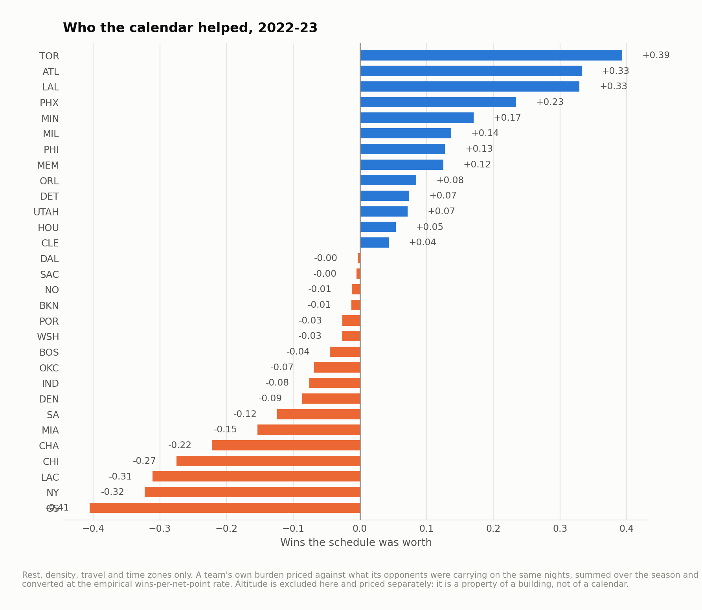
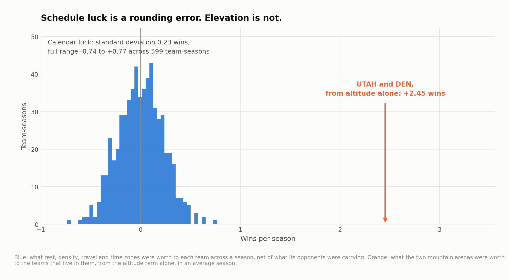
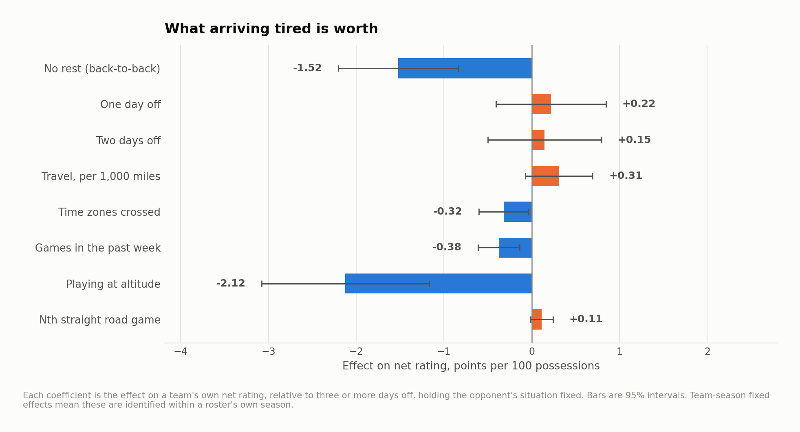
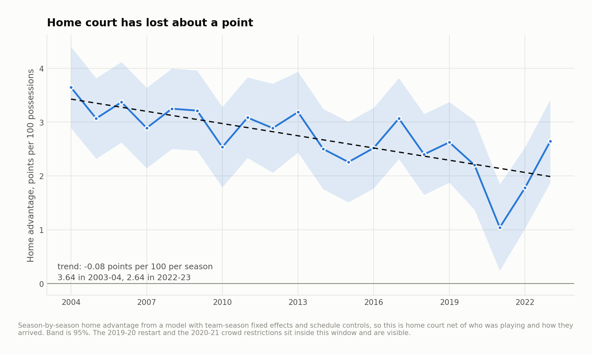
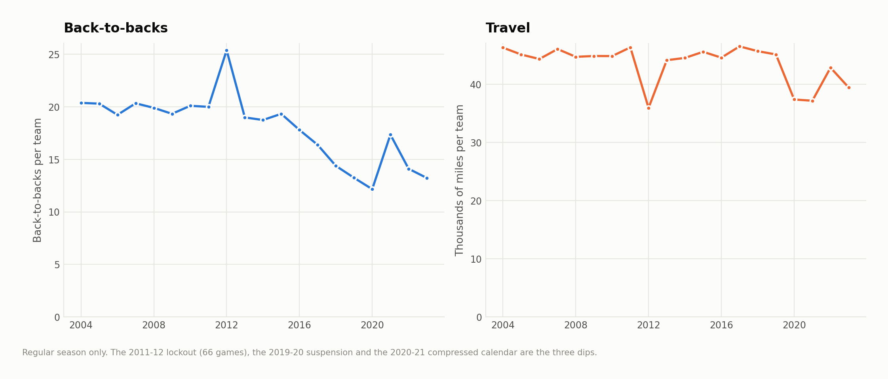

# The schedule tax

Twenty NBA regular seasons — 23,838 games, 2003-04 through 2022-23 — run through
a fixed-effects model that prices what a team arrived with: rest, travel, time
zones, how many games it had already played that week, and where the building is.

The question this started from was whether the schedule complaints are real, and
how much of a team's record you should discount for a hard calendar.

The answer is: less than almost anyone thinks. And the thing that actually
decides games has nothing to do with the calendar at all.

---

## Two findings

**A season's worth of schedule luck is about a quarter of a win.**

Across 599 team-seasons, the total effect of rest, density, travel and time
zones — a team's own burden priced against what its opponents were carrying on
the same nights — has a standard deviation of **0.23 wins**. The full range over
twenty seasons runs from −0.74 (Cleveland, 2007-08) to +0.77 (Orlando, 2004-05).
Within a single season, the gap between the most and least favored team averages
**0.90 wins**.

That is not zero, and in a play-in race it is not nothing. But it is an order of
magnitude smaller than the way schedule strength gets talked about, and the
reason is structural: everyone plays back-to-backs, everyone flies, and a team
with a heavy week is usually playing someone who also has one. Most of the
burden nets out before it reaches the standings.



**Playing at altitude is worth ten times as much, every year, to the same two
teams.**

Denver and Utah collect **+2.45 and +2.46 wins per season** from their elevation
alone — larger than the entire twenty-year range of calendar luck, and it arrives
every single year rather than at random.



---

## What each night is worth

All effects are on a team's own net rating, in points per 100 possessions,
against a baseline of three or more days off. Team-season fixed effects mean each
one is identified from variation inside a single roster's own season.

| | Points per 100 | Std. error | t |
|---|---|---|---|
| No rest (back-to-back) | **−1.52** | 0.35 | −4.4 |
| One day off | +0.22 | 0.32 | 0.7 |
| Two days off | +0.15 | 0.33 | 0.4 |
| Playing at altitude | **−2.12** | 0.49 | −4.4 |
| Games in the past week, each | **−0.38** | 0.12 | −3.1 |
| Time zones crossed, each | **−0.32** | 0.15 | −2.2 |
| Travel, per 1,000 miles | +0.31 | 0.20 | 1.6 |
| Nth straight road game | +0.11 | 0.07 | 1.8 |



Three things in that table are worth pulling out.

**Rest is a cliff, not a slope.** The entire effect is in the back-to-back. One
day off is statistically indistinguishable from four. Whatever fatigue does to an
NBA team, a single night of sleep clears most of it — which is an argument for
planning rotations around the second night of a back-to-back specifically, and
against treating "days of rest" as a continuous input to anything.

**Miles do not matter. Time zones do.** Raw distance carries the wrong sign and
does not reach significance once rest and time zones are controlled. Each time
zone crossed costs about a third of a point per 100. Chartered flights have made
distance close to free; what remains is the body clock. A team's travel burden is
better described by its longitude than its odometer.

**Density is real and cumulative.** Each additional game in the trailing seven
days costs about 0.38 points per 100, on top of the back-to-back effect. Four
games in six nights is worth roughly a point and a half of net rating before
anyone gets on a plane.

---

## The altitude term, and how much to trust it

A continuous per-foot altitude term is the obvious specification and it is the
wrong one. Fitting a separate home bonus for each elevated venue — over and above
that season's league-wide home advantage, with team quality already absorbed —
gives this:

| Venue | Elevation | Home games | Bonus, points per 100 | Std. error |
|---|---|---|---|---|
| Denver | 5,280 ft | 797 | **+2.14** | 0.65 |
| Salt Lake City | 4,226 ft | 794 | **+2.26** | 0.65 |
| Oklahoma City | 1,201 ft | 663 | +0.41 | 0.70 |
| Phoenix | 1,086 ft | 795 | −0.35 | 0.65 |
| Atlanta | 1,050 ft | 798 | +0.28 | 0.65 |

The effect is not proportional to elevation. Salt Lake City, a thousand feet
lower, gets the same bonus as Denver, and nothing around a thousand feet shows
anything at all. So altitude enters the model as a threshold — a team that lives
near sea level playing in the mountains — rather than as a slope, and the model
is honest about the shape of what it found instead of imposing a tidier one.

Two caveats I would raise before anyone acts on this. First, the term is
identified off two buildings, so "altitude" is not cleanly separable from
"Denver and Salt Lake City". Everything else those two arenas have in common
loads onto this coefficient. Second, the point estimates are about 2.1 and 2.3
points per 100 with standard errors around 0.65, so the honest statement is
"somewhere between one and three and a half points", not "2.12".

What survives both caveats is the comparison that matters: whatever it is, it is
much larger and much more reliable than anything the schedule maker does.

---

## Home court is shrinking

The model estimates home advantage separately for each season, net of team
quality and of how both teams arrived.



**3.64 points per 100 in 2003-04, 2.64 in 2022-23**, trending at −0.08 per
season. The floor is 2020-21 at **1.04**, the season played in mostly empty
buildings, which is about as close to a natural experiment on crowds as this
sport provides — and it puts a number on the crowd's share of home court that is
hard to get any other way.

Note also what is *not* driving the decline: the schedule got easier over the
same period, which would push the other way. Back-to-backs per team fell from
about 20 to 13 and travel from 46,000 miles a season to 39,000.



---

## How the model works

One row per game, from the home team's side. The outcome is home net rating —
points per 100 possessions minus points allowed per 100, with possessions
estimated from the box score.

```
net_home  =  strength(home team, that season)
           − strength(away team, that season)
           + home advantage for that season
           + schedule terms, entered as home minus away
           + error
```

R² is 0.229 with a residual standard deviation of 12.3 points per 100. That
residual is the sport: a single NBA game is mostly noise, and any model of one
that fits much better is fitting something it should not be.

**Schedule terms are differenced rather than fit separately for each side.** That
imposes the restriction that a day of rest is worth the same to whoever has it.
`run_02_model.py` fits the unrestricted version and reports the test: across all
eight terms the home and away coefficients sum to zero within 1.8 standard
errors, so the restriction holds and buys back eight degrees of freedom.

**Team-season fixed effects, not team fixed effects.** A franchise is a different
team every October. Season-specific effects mean a schedule coefficient can only
be identified by comparing a roster to itself.

**The 2019-20 restart is excluded, not averaged in.** Eighty-eight games played
by twenty-two teams in one Florida complex, with no travel, no crowd and three
months off, is not a data point about rest and travel.

**Wins are converted at the rate this data implies**, not a rule of thumb:
regressing team-season win percentage on net rating gives 2.50 wins per point of
net rating over 82 games, with r = 0.97.

---

## What this does not do

- **No injury or rest-decision data.** If teams already sit players on the second
  night of a back-to-back, then −1.52 is the effect *after* whatever mitigation
  the league already applies. It is the residual damage, not the raw damage, and
  the true untreated cost is larger.
- **Possessions are estimated**, using FGA + 0.44×FTA − OREB + TOV. At the level
  of a whole game the 0.44 is fine; it would not be at the level of a stint.
- **Travel is measured as flown**, city center to city center, and ignores when a
  team actually flew. A team that travels after a night game and one that flies
  in the morning look identical here.
- **Regular season only.** Playoff rest patterns are a different problem.
- **2022-23 is the last season**, which is where the public play-by-play mirror
  this project reads currently ends.

---

## Running it

```bash
pip install -r requirements.txt
python src/run_01_build.py   # schedules + box scores -> the team-game panel
python src/run_02_model.py   # the fixed-effects fit, figures 01-03
python src/run_03_luck.py    # season totals in wins, figures 04-05
```

Or `make all`. The whole pipeline takes about two minutes.

```
src/
  config.py      paths, seasons, the altitude threshold
  venues.py      every city the league played in, with elevation and time zone
  model.py       the design matrix and the estimator
  run_0*.py      the pipeline, in order
output/          every number quoted above, as CSV
figures/         five figures, regenerated from scratch by the pipeline
docs/method.md   longer notes, including what I tried that did not work
```

## Data

Schedules and team box scores from
[sportsdataverse/hoopR-data](https://github.com/sportsdataverse/hoopR-data),
which mirrors ESPN's public feeds. `data/README.md` has the fetch step.

## License

MIT. See `LICENSE`.
